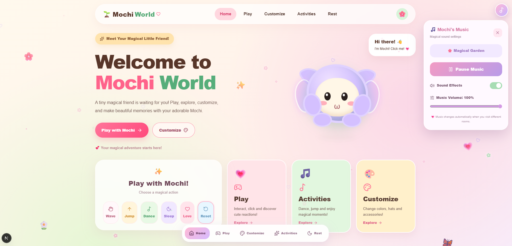
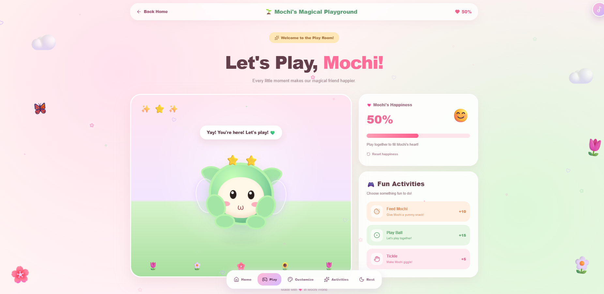
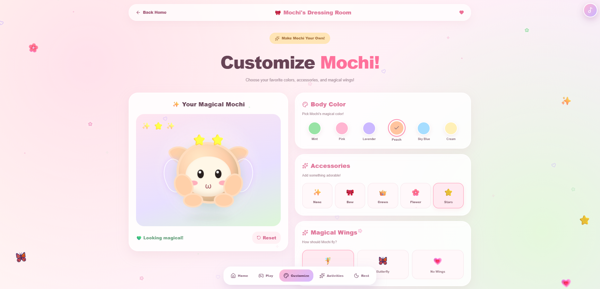
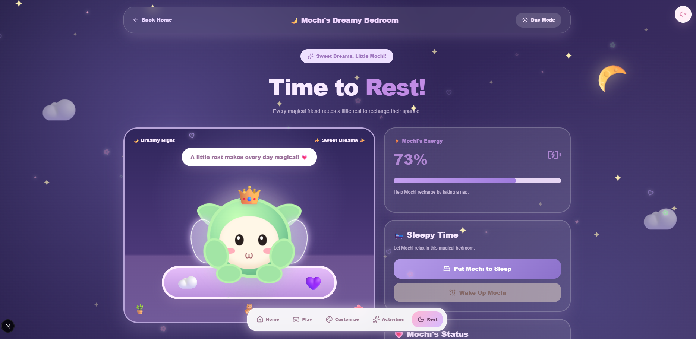

# 🌸 Mochi World — Your Magical Little Friend

**Mochi World** is a cute, interactive virtual pet web application built with Next.js, React, and TypeScript. It brings a magical little creature to life through playful animations, customization, interactive mini-games, relaxing activities, and delightful sound effects.

Designed with a dreamy pastel aesthetic, Mochi World offers an engaging and responsive virtual companion experience.

### 🌐 Live Demo & Repository

- 🚀 **Live Website:** [mochi-world.vercel.app](https://mochi-world.vercel.app/)
- 💻 **GitHub Repository:** [github.com/sevi2001/mochi-world](https://github.com/sevi2001/mochi-world)

---

## ✨ Features

### 💚 Interactive Mochi Character
- Animated blinking eyes and cursor-following effects
- Jumping, dancing, waving, sleeping, and love animations
- Interactive petting with floating hearts
- Smooth character movement and expressive reactions

### 🎮 Magical Play Room
- Interactive playtime experiences
- Cute character reactions and animated effects
- Happiness tracking and playful interactions

### 🎀 Customize Room
- Multiple body colors and appearance options
- Cute accessories and magical wings
- Live character customization preview
- Automatic customization saving using Local Storage

### 🎵 Activities Room
- Dance Party, Jump Challenge, and Friendship Magic
- Animated activities and visual effects
- Star rewards and progress tracking
- Unlockable achievements
- Persistent activity progress

### 🌙 Magical Rest Room
- Interactive day and night modes
- Sleeping and waking animations
- Energy recharging system
- Twinkling stars, glowing moon, and floating clouds
- Saved energy and sleep status

### 🎶 Music & Sound Effects
- Cute sound effects for character interactions
- Original synthesized background melodies
- Different music moods for different rooms
- Music volume control
- Separate music and sound-effect settings
- Browser-based Web Audio API

### 🌸 UI/UX & Animations
- Dreamy pastel-themed interface
- Floating magical particles
- Sparkling cursor trail
- Smooth page transitions
- Animated buttons and hover effects
- Responsive layouts for desktop, tablet, and mobile
- Floating navigation menu

---

## 🛠️ Technologies Used

| Technology | Purpose |
|---|---|
| Next.js | Application framework and routing |
| React | Interactive UI components |
| TypeScript | Type-safe development |
| Tailwind CSS | Responsive interface styling |
| CSS3 | Custom styling and animations |
| Motion | Smooth and interactive animations |
| Lucide React | Modern UI icons |
| Web Audio API | Music and sound effects |
| Local Storage | Saving preferences and progress |
| Git & GitHub | Version control |
| Vercel | Hosting and deployment |

---

## 📂 Project Structure

```text
mochi-world/
├── app/
│   ├── page.tsx
│   ├── layout.tsx
│   ├── globals.css
│   ├── play/page.tsx
│   ├── customize/page.tsx
│   ├── activities/page.tsx
│   └── rest/page.tsx
├── components/
│   ├── MochiCharacter.tsx
│   ├── SavedMochi.tsx
│   ├── MagicalParticles.tsx
│   ├── MagicalCursor.tsx
│   ├── MagicalNavigation.tsx
│   ├── MagicalPageTransition.tsx
│   └── MochiMusicPlayer.tsx
├── lib/
│   ├── sounds.ts
│   └── music.ts
├── types/
│   └── mochi.ts
├── public/
├── package.json
└── README.md
```

---

## 🚀 Getting Started

### 1. Clone the repository

```bash
git clone https://github.com/sevi2001/mochi-world.git
```

### 2. Navigate to the project directory

```bash
cd mochi-world
```

### 3. Install dependencies

```bash
npm install
```

### 4. Start the development server

```bash
npm run dev
```

### 5. Open the application

Visit http://localhost:3000 in your browser.

---

## 💾 Data Persistence

Mochi World uses browser Local Storage to save:

- Character customization preferences
- Activity progress and achievements
- Energy and sleeping status
- Music volume and sound preferences

The application does not require user registration or an external database.

---

## 🎯 Project Objectives

This project was developed to explore modern frontend development and create an enjoyable virtual pet experience.

It demonstrates:

- Reusable React components and TypeScript
- Next.js App Router navigation
- Interactive animation development
- React Hooks and state management
- Browser-based data persistence
- Responsive UI/UX design
- Web Audio API integration
- GitHub version control and Vercel deployment

---

## 🔮 Future Enhancements

- Additional mini-games and daily challenges
- More Mochi character accessories
- Friendship levels and daily rewards
- Improved character artwork and 3D animations
- More interactive environments
- Additional soundtracks and themes

---
## 📸 Screenshots

Explore the magical world of Mochi!

### 🏡 Homepage

Meet Mochi, your adorable magical companion.



### 🎮 Play Room

Enjoy fun interactions and playful moments with Mochi.



### 🎀 Customize Room

Personalize Mochi with beautiful colors, accessories, and wings.


### 🌙 Rest Room

Help Mochi relax, sleep, and recharge energy.



---

## 👩‍💻 Developer

**GitHub:** [sevi2001](https://github.com/sevi2001)

**Project:** [Mochi World](https://github.com/sevi2001/mochi-world)

**Live Demo:** [https://mochi-world.vercel.app/](https://mochi-world.vercel.app/)

---

Made with 💚, creativity, and a little magic! ✨
